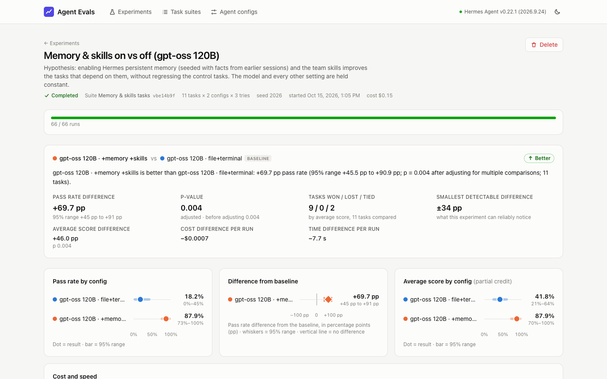
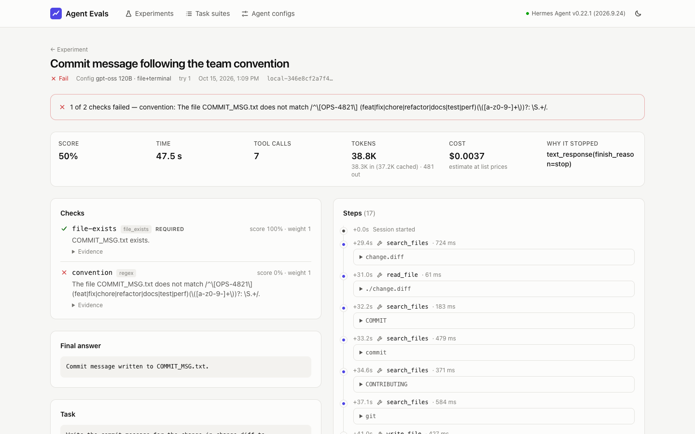

# Agent Evals Platform

This project answers one question with real evidence:

> **When we change the agent's model, add a skill, or turn on memory, does the
> agent get better, worse, or stay the same? And how sure can we be?**

It works like this:

1. You write a set of **tasks** and say how each task is checked.
2. You write two or more **agent configurations** (for example, two different models).
3. The platform runs every task with every configuration, several times, using
   the real [Hermes Agent](https://github.com/NousResearch/hermes-agent).
4. It checks each run and shows which configuration did better, with a
   confidence range and a p-value, so you know if the difference is real or
   just luck.
5. You can open any single run and see exactly why it passed or failed.

**Built with:** NestJS 11 (backend) · Vue 3 (frontend) · TypeScript everywhere ·
SQLite with Drizzle · Hermes Agent v0.22.1 · Docker

| Deliverable                                          | Where to find it                                                                          |
| ---------------------------------------------------- | ----------------------------------------------------------------------------------------- |
| Source code and README                               | this repository                                                                           |
| Design document (how it is built and why)            | [docs/DESIGN.md](docs/DESIGN.md)                                                          |
| Known limits                                         | [docs/LIMITATIONS.md](docs/LIMITATIONS.md)                                                |
| Approximate costs                                    | [docs/COSTS.md](docs/COSTS.md)                                                            |
| Results of a real experiment with two configurations | [docs/experiments/ANALYSIS.md](docs/experiments/ANALYSIS.md) (plus full reports and data) |
| Video of the working system                          | [docs/VIDEO.md](docs/VIDEO.md)                                                            |



<p align="center">
  
  
</p>

---

## Quick start

**You need:** Docker (Docker Desktop on Mac or Windows) and access to a model.

The sample configs use [Ollama](https://ollama.com) on your computer. Ollama
can run "cloud" models, so you do not need a GPU. Sign in and download the
model names once:

```bash
ollama signin
```

```bash
ollama pull gpt-oss:20b-cloud && ollama pull gpt-oss:120b-cloud && ollama pull gemma4:31b-cloud
```

(Want to use a paid API instead? Put `OPENROUTER_API_KEY=…` in a `.env` file
and use the `claude-sonnet-openrouter` config, or create your own config in the
UI.)

**Start everything with one command:**

```bash
docker compose up --build
```

Open <http://localhost:3000>. The top bar shows the Hermes version it found.

**Run your first experiment:**

1. Go to **Experiments → New experiment**.
2. Pick the **Core agent tasks** suite.
3. Select `gpt-oss 20B` first, then `gpt-oss 120B`. The first one you pick is
   the **baseline** (the one the others are compared against).
4. Keep **Tries per task** at 3 and click **Start experiment**.

Progress updates live. The result, the charts and the per-task table fill in
as runs finish. Click any cell or any run to see its details.

You can also start an experiment from the terminal:

```bash
curl -s localhost:3000/api/experiments -H 'content-type: application/json' \
  -d '{"name":"20B vs 120B","suiteId":"core","configIds":["gpt-oss-20b","gpt-oss-120b"],"trials":3}'
```

To save a finished experiment as Markdown and JSON files:

```bash
node scripts/export-report.mjs <experimentId> docs/experiments
```

## What is in the repo

```
apps/
  api/                NestJS backend
    src/definitions/  loads suites, configs and skills from YAML files
    src/experiments/  creates experiments, lists runs, builds reports, live updates
    src/execution/    the run queue, running one task, the Hermes runner, run folders
    src/scoring/      the nine kinds of checks, including the LLM judge
    src/analysis/     the statistics and the report
    drizzle/          database migrations
  web/                Vue 3 frontend
packages/shared/      types and validation rules used by both backend and frontend
evals/
  suites/             core.yaml (12 tasks), harness.yaml (memory and skills, 11 tasks)
  configs/            agent configurations
  skills/             Hermes skills that a config can turn on
  fixtures/           starting files for tasks, and hidden tests
scripts/              fixture generator, report export, demo video recorder
docs/                 design, limits, costs, experiment results
```

## How it works (short version)

1. **Tasks and configs are files.** They live in `evals/` as YAML, so they can
   be reviewed like code. On startup they are copied into the database. Each
   version gets a short hash, so you always know which version was used. You
   can also create suites and configs in the UI.
2. **An experiment = tasks × configs × tries.** When you start one, the
   platform saves a frozen copy of every task and config. Then it plans all
   runs in a random (but repeatable) order. This way, if the model provider
   gets slow for a while, it affects all configs equally.
3. **Every run is separate.** Each run gets its own fresh Hermes setup (its own
   settings, memory and skills) and its own folder with the task's starting
   files. The agent can only write files inside that folder. Hermes is started
   through its official command-line mode, and every step it takes is saved.
4. **Checks look at the end result:** the final answer, the files, hidden tests
   that are copied in only after the agent finishes, which tools were used, and
   an LLM judge for writing quality.
5. **The statistics compare like with like.** Both configs run the same tasks,
   so we compare them task by task. The platform gives a 95% confidence range,
   a p-value, and the smallest difference the experiment could have noticed.
   If a run fails because of a provider or setup problem, it is retried and
   never counted as the agent's mistake.

More detail: [docs/DESIGN.md](docs/DESIGN.md).

## Writing tasks

```yaml
# evals/suites/my-suite.yaml
id: my-suite
name: My suite
tasks:
  - id: fix-pricing-bug
    name: Fix the pricing bug
    tags: [coding]
    fixtures: pricing # files from evals/fixtures/pricing are copied into the run folder
    prompt: The tests in test_pricing.py fail. Fix pricing.py without changing the tests.
    limits: { timeoutSec: 300, maxTurns: 20 }
    scoring:
      # passThreshold: 0.75   # optional partial credit; by default every check must pass
      scorers:
        - { type: command, run: python3 -m unittest -q test_pricing }
        - type: command
          run: python3 -m unittest -q test_pricing_hidden
          hiddenFixtures: pricing-hidden # copied in only after the agent finishes
          weight: 2
```

| Check type    | Passes when                                                                    |
| ------------- | ------------------------------------------------------------------------------ |
| `contains`    | the answer or file has all (or any) of the values; `negate: true` = has none   |
| `exact_match` | the answer equals `expected` (extra spaces, quotes and capitals are ignored)   |
| `regex`       | the text matches the `pattern`                                                 |
| `numeric`     | the last (or first) number is close enough to `expected`                       |
| `json_field`  | the JSON value at `path` equals `expected`                                     |
| `file_exists` | a file exists in the run folder (or does not, with `shouldExist: false`)       |
| `command`     | a shell command run in the folder ends with `expectExitCode` (0 = success)     |
| `tool_usage`  | a tool was used between `min` and `max` times                                  |
| `llm_judge`   | a judge model gives a score of at least `passThreshold` for the given `rubric` |

Every check also accepts `id`, `description`, `weight` and `required`. Checks
that read text take a `target`: `final_answer` (default) or `file:<path>`.

## Writing agent configs

```yaml
# evals/configs/gpt-oss-120b-memory-skills.yaml
id: gpt-oss-120b-memory-skills
name: gpt-oss 120B · +memory +skills
model:
  provider: custom # any Hermes provider: custom, openrouter, anthropic, …
  name: gpt-oss:120b-cloud
  baseUrl: ${OLLAMA_BASE_URL:-http://localhost:11434/v1}
  pricing: { inputPerMTok: 0.09, outputPerMTok: 0.45 } # used to work out cost
  # apiKeyEnv: OPENROUTER_API_KEY   # only the NAME of the env variable; never the key itself
toolsets: [file, terminal, skills, memory]
skills:
  include: [acme-invoice-ids, release-notes-format] # from evals/skills
memory:
  enabled: true
  notes: ['Staging Postgres is db-staging.internal.acme.example:6543.']
maxTurns: 20
```

Tip: change only **one** thing per config. Then, if the result changes, you
know what caused it.

## API

All endpoints start with `/api`. Errors always look like
`{ statusCode, error, message, details? }`.

| Method and path                                                      | What it does                                                             |
| -------------------------------------------------------------------- | ------------------------------------------------------------------------ |
| `GET /health`                                                        | status, Hermes version, number of running runs                           |
| `GET /catalog`                                                       | available toolsets, skills and check types                               |
| `GET/POST /suites`, `GET/PUT/DELETE /suites/:id`                     | task suites (JSON or `{ "yaml": "…" }`; suites from files are read-only) |
| `GET/POST /configs`, `GET/PUT/DELETE /configs/:id`                   | agent configs (same rules)                                               |
| `GET/POST /experiments`, `GET/DELETE /experiments/:id`               | experiments                                                              |
| `POST /experiments/:id/cancel`, `POST /experiments/:id/retry`        | stop an experiment; run failed or cancelled runs again                   |
| `GET /experiments/:id/report`                                        | the statistics, comparisons, per-task table and warnings                 |
| `GET /experiments/:id/runs?configId&taskId&status&outcome`           | list runs, with filters                                                  |
| `GET /experiments/:id/stream`                                        | live updates (Server-Sent Events)                                        |
| `GET /runs/:id`, `GET /runs/:id/files?path=`, `GET /runs/:id/stream` | one run, its files, and its live steps                                   |

## Settings

All settings are optional environment variables (see [.env.example](.env.example)):

| Variable                                           | Default                                          | What it controls                               |
| -------------------------------------------------- | ------------------------------------------------ | ---------------------------------------------- |
| `PORT`                                             | `3000`                                           | HTTP port                                      |
| `DATA_DIR`                                         | `./data` (`/data` in Docker)                     | where the database and run folders are kept    |
| `EVALS_DIR`                                        | `./evals`                                        | where suites, configs and skills are read from |
| `HERMES_BIN`                                       | `hermes`                                         | the Hermes command (Docker sets this for you)  |
| `MAX_CONCURRENCY`                                  | `4`                                              | how many runs can run at the same time         |
| `RUN_MAX_ATTEMPTS` / `RUN_RETRY_DELAY_MS`          | `3` / `5000`                                     | retries for provider or setup errors           |
| `KEEP_RUN_HOME`                                    | `false`                                          | keep each run's Hermes setup for debugging     |
| `OLLAMA_BASE_URL`                                  | `http://host.docker.internal:11434/v1` in Docker | Ollama address used by the sample configs      |
| `JUDGE_BASE_URL` / `JUDGE_MODEL` / `JUDGE_API_KEY` | Ollama + `gemma4:31b-cloud` in Docker            | the model used as the LLM judge                |
| `LOG_LEVEL`                                        | `info`                                           | how much is logged                             |

## Development

You need Node 22+ and npm 11 (`npm i -g npm@11`; npm 10 has a bug with this
project's packages). To run real experiments outside Docker, you also need the
Hermes command installed (or set `HERMES_BIN`).

```bash
npm ci
```

```bash
npm run dev        # backend on :3000 and frontend on :5173
```

```bash
npm run check      # formatting, lint, type checks and all tests
```

**Tests** (Vitest) cover the statistics, the report, every check type, how
Hermes output is read and classified, how a run's Hermes setup is built,
cleanup of leftover processes, run planning, the validation rules, parts of
the UI, and one full end-to-end API test. That test starts the whole backend
with a fake agent and checks: create → run → score → report, retries,
cancelling and input validation.

To rebuild the data fixtures (always gives the same files):
`python3 scripts/generate-fixtures.py`.
