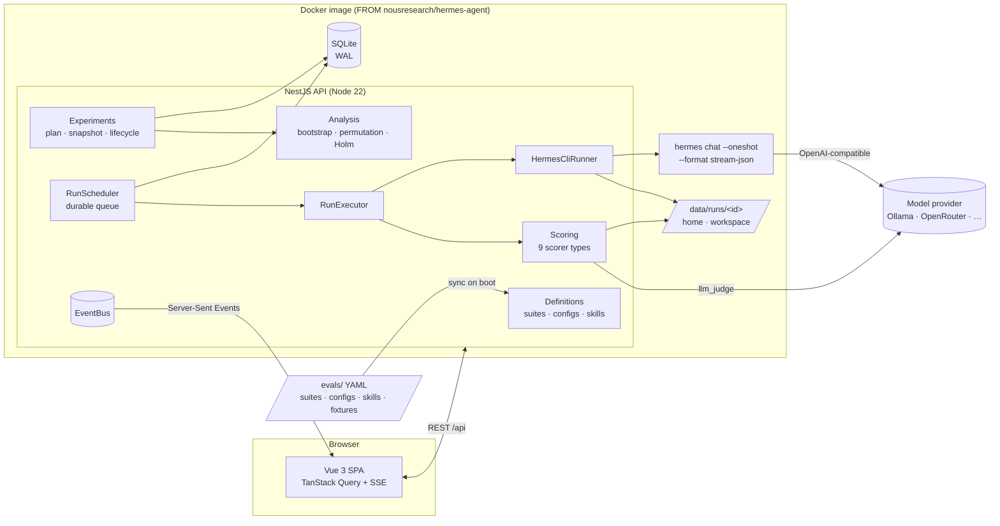
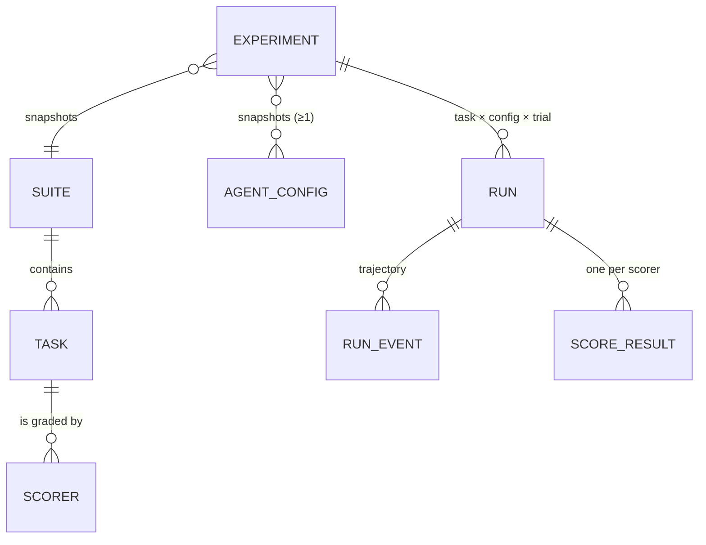

# Design: Agent Evals Platform

This document explains how the platform answers one question — _"did this
change to the agent make it better, worse, or no different, and how sure are
we?"_ — and why it is built the way it is.

- [1. Goals and non-goals](#1-goals-and-non-goals)
- [2. Architecture](#2-architecture)
- [3. Domain model](#3-domain-model)
- [4. Running a task on Hermes](#4-running-a-task-on-hermes)
- [5. Scoring](#5-scoring)
- [6. Statistics: how confident can we be?](#6-statistics-how-confident-can-we-be)
- [7. Execution engine](#7-execution-engine)
- [8. API and UI](#8-api-and-ui)
- [9. Key decisions and trade-offs](#9-key-decisions-and-trade-offs)
- [10. Assumptions](#10-assumptions)
- [11. Scaling path](#11-scaling-path)

## 1. Goals and non-goals

**Goals**

1. Define tasks and how each is scored, as reviewable code.
2. Define agent configurations — model, toolsets, skills, memory, persona, turn
   budget — and compare any two or more of them.
3. Run every task under every configuration, repeatedly, on the real Hermes
   Agent harness, with each run isolated from every other.
4. Report whether a configuration is better, worse or indistinguishable, with
   honest uncertainty (intervals, p-values, detectable effect size).
5. Let a person open any run and see _why_ it passed or failed: the checks with
   their evidence, the full trajectory, and the files the agent left behind.
6. Run locally with one command.

**Non-goals (for this version)**

- Multi-tenant SaaS concerns (auth, quotas, billing). It is an internal tool.
- Distributed execution across machines (the design leaves room for it; §11).
- Training-data generation or prompt optimisation. It measures; it does not tune.

## 2. Architecture



**One deployable.** The API serves the built SPA and runs every agent run as
a child process of itself, inside an image built on the official
`nousresearch/hermes-agent` image. `docker compose up --build` is the whole
setup.

**Modules** (NestJS, one responsibility each):

| Module        | Responsibility                                                                                                                                                                                |
| ------------- | --------------------------------------------------------------------------------------------------------------------------------------------------------------------------------------------- |
| `definitions` | Loads `evals/suites`, `evals/configs`, `evals/skills` from YAML, validates with the shared zod schemas, versions them by content hash, exposes CRUD (UI-created definitions) and the catalog. |
| `experiments` | Creates experiments (plan + frozen snapshot), lists runs, builds reports, cancel/retry/delete, run detail and workspace file access, SSE streams.                                             |
| `execution`   | `RunScheduler` (durable queue, concurrency, recovery), `RunExecutor` (one run end to end), `HermesCliRunner` (the Hermes adapter), workspace management.                                      |
| `scoring`     | Scorer registry and the nine scorer strategies, including the LLM judge client.                                                                                                               |
| `analysis`    | Pure statistics (`stats.ts`) and the report builder. No framework code: trivially unit-testable.                                                                                              |
| `events`      | In-process pub/sub: live events to browsers, domain events between modules.                                                                                                                   |

**Shared contract.** `packages/shared` holds the zod schemas for tasks,
scorers, configs and experiment requests, plus the TypeScript types of every
API response. The API validates requests with them and the UI validates forms
with the same schemas, so the two cannot drift.

## 3. Domain model



- **Suite / Task / Scorer** — definitions as code (`evals/suites/*.yaml`). A
  task has a prompt, an optional fixture directory copied into the workspace,
  limits (timeout, max turns) and a list of scorers.
- **AgentConfig** — the independent variable: model (provider, name, endpoint,
  pricing), toolsets, skills (`evals/skills/*` opted into by id), memory (on/off
  plus seeded entries), persona, turn budget, and an escape hatch for any other
  Hermes `config.yaml` key.
- **Experiment** — suite × configs × trials, with a **frozen snapshot** of every
  definition (and its content hash) at launch. Editing a suite later never
  changes what an old experiment means.
- **Run** — one (task, config, trial) execution: status, outcome, score,
  usage/cost, final answer, workspace file list, trajectory and score results.

Persistence is SQLite through Drizzle ORM with SQL migrations committed in
`apps/api/drizzle`. Timestamps are ISO strings; JSON columns hold definitions,
snapshots, usage and evidence.

## 4. Running a task on Hermes

### Integration surface

Hermes offers two programmatic surfaces: its Python `AIAgent` class and its
CLI. The platform uses the **documented one-shot CLI contract**:

```
hermes --usage-file <run>/usage.json chat --oneshot --query-file <run>/prompt.txt \
  --format stream-json --source tool --yolo --max-turns N --toolsets file,terminal [--skills …]
```

- `--format stream-json` emits one JSON event per line (`system`, `text`,
  `tool_use`, `tool_result`, `result`) — exactly the trajectory we need.
- `--usage-file` writes tokens, API calls, cost and the turn exit reason, even
  when the run fails.
- It is language-agnostic (Node spawns it directly), isolates every run in its
  own process, and is the interface Hermes commits to for scripted callers. The
  Python internals, by contrast, are explicitly not API in Hermes' own
  contributor guide and change constantly.

### Per-run isolation

Every run gets a fresh directory `/data/runs/<runId>/` with:

| Path         | Purpose                                                                                                                                                                                                                             |
| ------------ | ----------------------------------------------------------------------------------------------------------------------------------------------------------------------------------------------------------------------------------- |
| `home/`      | A brand-new `HERMES_HOME`: generated `config.yaml`, `SOUL.md` persona, seeded `memories/MEMORY.md` and `USER.md`, only the opted-in skills, and a `.no-bundled-skills` marker so the skill set is exactly what the config declares. |
| `workspace/` | The agent's working directory, seeded with the task fixtures. `HERMES_WRITE_SAFE_ROOT` is set to it, so Hermes' file tools hard-refuse writes elsewhere.                                                                            |
| `rt/`        | `XDG_RUNTIME_DIR` for Hermes' sockets and locks.                                                                                                                                                                                    |

The generated `config.yaml` pins everything that is _not_ under test: background
memory/skill review and title generation are off (they add cost and
nondeterminism outside the task), the run budget and turn limit come from the
task, the gateway's idle exit is short.

The child process receives a **minimal environment**: `PATH`, locale, Hermes'
own `HERMES_*` variables, and only the API-key variable the config names. Other
secrets (for example the judge key) never reach the agent, which can run
arbitrary shell commands.

### Normalising the outcome

| Hermes signal                                       | Run status                         | Counts as                              |
| --------------------------------------------------- | ---------------------------------- | -------------------------------------- |
| `result.exit_code = 0`                              | completed                          | scored normally                        |
| exit reason `max_iterations…`                       | completed, `errorKind = max_turns` | scored (usually fails) — agent's fault |
| our hard timeout / run budget hit                   | completed, `errorKind = timeout`   | scored — agent's fault                 |
| HTTP 401/402/403/429/5xx, quota, connection errors  | **infra error**                    | retried with backoff, then excluded    |
| failed before any model call, or no `result` record | **infra error** (harness)          | retried, then excluded                 |
| experiment cancelled                                | cancelled                          | excluded                               |

The "failed before any model call" rule came from a real bug found during
development: a CLI flag Hermes rejects produced an `exit_code: 1` that was
initially scored as an agent failure. Classifying it as infrastructure keeps a
broken harness from masquerading as a worse model.

### Hermes process lifecycle

`hermes chat` auto-starts a detached gateway daemon (own session, PPID 1) per
`HERMES_HOME`. Two consequences surfaced under concurrency and are handled:

1. **Leaks and collisions.** The daemon outlives the CLI. After every run the
   runner reaps every process whose environment carries the run's
   `HERMES_HOME` (a `/proc` scan, falling back to `gateway.pid`), and the
   generated config sets a short idle exit as a second line of defence.
   Without this, a retry in the same directory collided with the previous
   attempt's gateway, and memory grew by ~250 MB per finished run.
2. **Thundering herd.** Several cold starts at once compete for CPU until one
   misses Hermes' 60 s gateway start deadline. A `HermesStartupGate` admits one
   cold start at a time and opens as soon as the run produces its first agent
   event; runs still execute in parallel afterwards.

## 5. Scoring

A scorer turns the end state of a run into `{score ∈ [0,1], passed, reason,
evidence}`. The reason is a sentence a human can read; the evidence is the
raw material (matched text, command output, judge rationale).

| Type          | Checks                                                                               | Typical use                        |
| ------------- | ------------------------------------------------------------------------------------ | ---------------------------------- |
| `contains`    | values present in the answer or a file (all/any; `negate` for "must not contain")    | facts, forbidden content (secrets) |
| `exact_match` | normalised equality                                                                  | IDs, single-word answers           |
| `regex`       | pattern match                                                                        | formats, config lines              |
| `numeric`     | last/first number within tolerance                                                   | calculations                       |
| `json_field`  | value at a dot path of a JSON answer/file                                            | structured outputs                 |
| `file_exists` | presence/absence of a workspace file                                                 | deliverables                       |
| `command`     | exit code of a shell command in the workspace; can first copy in **hidden fixtures** | hidden unit tests, graders         |
| `tool_usage`  | how often a tool was called                                                          | "must use / must not use X"        |
| `llm_judge`   | rubric graded 0–10 by an OpenAI-compatible model at temperature 0                    | qualities strings cannot check     |

**Task score** is the weighted mean of scorer scores (a continuous metric with
partial credit). **Pass/fail**: every `required` scorer must pass, and either
every scorer passes (default) or the weighted score reaches the task's
`passThreshold`. Pass rate is the primary metric; mean score is secondary.

Design choices:

- **Grade the end state, not the transcript.** Hidden tests copied in _after_
  the agent finished mean the agent cannot overfit to or read them.
- **Deterministic first, judge second.** The sample suites use the LLM judge on
  two writing tasks only, always alongside deterministic checks, and the judge
  is a different model family from the models under test to avoid
  self-preference.
- **Scorer errors are visible, not silent.** A scorer that cannot run (judge
  unreachable) records `status: error`, counts as a failed check, and the
  report warns about it.
- **Harness annotations are stripped** from the final answer before scoring
  (Hermes appends a file-mutation verifier footer that would otherwise confuse
  numeric scorers); the raw text stays in the trajectory.

## 6. Statistics: how confident can we be?

Agents are stochastic and tasks differ wildly in difficulty. The analysis is
built around two facts:

1. **The task is the unit of analysis.** Trials of the same task are
   correlated. Treating 72 runs as 72 independent observations would make
   intervals far too narrow. Each task contributes its mean over trials.
2. **Comparisons are paired.** Both configs run the same tasks, so the
   comparison uses per-task differences, which removes task difficulty from
   the noise.

| Quantity                          | Method                                                                                                                                                             |
| --------------------------------- | ------------------------------------------------------------------------------------------------------------------------------------------------------------------ |
| Pass rate / mean score per config | mean over tasks of per-task means                                                                                                                                  |
| 95% interval per config           | **two-level cluster bootstrap**: resample tasks, then trials within each task (4,000 iterations)                                                                   |
| Difference vs baseline            | mean of per-task differences; 95% interval by the same two-level bootstrap on pairs                                                                                |
| p-value                           | **paired sign-flip permutation test** on per-task differences (exact enumeration for ≤ 16 tasks, Monte Carlo above); no normality assumption                       |
| Multiple configs                  | **Holm–Bonferroni** across all comparisons against the baseline                                                                                                    |
| Sensitivity                       | **minimum detectable effect** at 80% power: `(z₀.₉₇₅ + z₀.₈) · sd(diffs) / √n`                                                                                     |
| Verdict                           | `better` / `worse` only when the adjusted p < 0.05 **and** the interval excludes 0; otherwise `no detectable difference`; `insufficient data` below 2 paired tasks |

The verdict sentence always states the effect, interval, p-value and n, and a
"no detectable difference" verdict states how large an effect the experiment
could have detected — "not significant" is not presented as "equal".

Supporting practices:

- **Interleaved, seeded run order.** Runs of all configs are shuffled together,
  so a provider slowdown or rate limit hits every config alike instead of
  biasing whichever ran last.
- **Infrastructure errors are excluded**, counted, and retryable from the UI,
  so an outage does not make a config look worse.
- **Flaky tasks** (passed on some trials, failed on others) are flagged.
- **Reproducible.** All resampling uses the experiment's seed.

## 7. Execution engine

The `runs` table _is_ the queue.

- **Claiming** is one SQLite transaction: pick the oldest experiment's next run
  by shuffled `queue_order` whose experiment is below its own concurrency
  limit, and mark it `running`. better-sqlite3 is synchronous and the
  scheduler is single-process, so this is atomic without extra locks.
- **Global concurrency** (`MAX_CONCURRENCY`) bounds runs in flight across
  experiments; each experiment has its own limit too.
- **Wake-ups** come from domain events (experiment launched/retried) with a
  5-second poll as a safety net.
- **Crash recovery.** On boot, runs left `running` are re-queued and their
  partial trajectories discarded. Graceful shutdown aborts in-flight runs with
  a `shutdown` reason so they are re-queued rather than marked cancelled.
- **Retries.** Infrastructure errors are retried up to `RUN_MAX_ATTEMPTS` with
  exponential backoff while holding the slot (so a throttled provider gets
  relief), and re-queued at the end of the experiment's queue.
- **Cancellation** marks queued runs cancelled and aborts in-flight ones
  (process-group kill + gateway reaping).

## 8. API and UI

REST under `/api` (see the README for the full table), with Server-Sent Events
for live progress (`/api/experiments/:id/stream`, `/api/runs/:id/stream`).
Errors share one JSON shape (`statusCode`, `error`, `message`, `details`).

The UI (Vue 3, TypeScript, Vue Router, TanStack Query, Tailwind) is organised
around the questions people ask:

- **Experiment page — "which is better and how sure are we?"** Verdict cards
  in plain language with effect, interval, adjusted p, wins/losses/ties and
  detectable effect; interval plots per config; a forest plot of differences
  vs baseline; a cost and efficiency table; a task × config heatmap (cells
  show passes/runs so colour is never the only channel; clicking filters the
  runs); the runs table; the method.
- **Run page — "why did it pass or fail?"** A one-line headline (first failing
  required check), each check with its reason and evidence, the final answer,
  the trajectory with tool calls paired to their results, the workspace after
  the run with created/edited markers and a file viewer, the exact config
  snapshot and the harness log.
- **Suites and configs** — browse tasks and checks; create suites in a YAML
  editor and configs in a form, both validated live with the shared schemas.

Charts follow a validated categorical palette for config identity (assigned by
position, never by rank), a single-hue sequential ramp for the heatmap,
reserved status colours that always come with an icon and label, and selected
light and dark themes.

## 9. Key decisions and trade-offs

| Decision                                                      | Alternatives considered                                | Why                                                                                                                                                                                                    |
| ------------------------------------------------------------- | ------------------------------------------------------ | ------------------------------------------------------------------------------------------------------------------------------------------------------------------------------------------------------ |
| Drive Hermes through its one-shot `stream-json` CLI           | Import `AIAgent` via a Python sidecar                  | Documented contract, process isolation, no Python bridge to maintain, trajectory and usage for free. Cost: ~5–10 s of start-up per run.                                                                |
| Fresh `HERMES_HOME` per run                                   | Hermes profiles; one shared home                       | Memory and skills are per-home by design; a shared home would leak memory between runs and configs.                                                                                                    |
| Definitions as code (YAML in git) + DB copy versioned by hash | DB-only CRUD                                           | Tasks and scorers deserve code review and history; the DB copy plus experiment snapshots keep old results meaningful. UI-created definitions are still supported.                                      |
| SQLite + Drizzle, table-as-queue                              | Postgres + BullMQ/Redis                                | One-command local run with zero services; transactions make the queue correct for a single node. Drizzle's dialects make Postgres a contained change.                                                  |
| Task-clustered, paired, non-parametric stats                  | Per-run t-test or chi-square                           | Runs are not independent and pass rates are bounded; permutation and bootstrap make no normality assumption and work at small n.                                                                       |
| Infra errors excluded and retried; timeouts count as failures | Count everything as failure                            | A provider outage should not penalise a config; a slow agent should.                                                                                                                                   |
| One container for API + Hermes                                | Spawn a Hermes container per run via the Docker socket | Mounting the Docker socket is a bigger security hole than the isolation it buys; per-run directories, the write sandbox and minimal env give reasonable isolation for trusted tasks (see LIMITATIONS). |
| SSE for live updates                                          | WebSockets, polling                                    | One-way server → browser stream, works through proxies, trivial in NestJS.                                                                                                                             |
| zod schemas shared by API and UI                              | class-validator DTOs                                   | One source of truth for request and definition validation on both sides.                                                                                                                               |

## 10. Assumptions

- **Hermes Agent v0.22.1** (pinned image tag) and its documented one-shot CLI
  contract. Newer versions should work; the stream parser ignores unknown
  event types.
- Tasks are **single-turn**: one user message, then the agent works
  autonomously until it answers. Multi-turn conversations with a simulated
  user are out of scope.
- Task and scorer definitions are **trusted code** reviewed like any other code
  (scorer commands run in the container).
- Agent **tool use is offline by default** (file + terminal). Web/browser
  toolsets work but need network access and keys, and make results less
  reproducible.
- Models are reached through **any Hermes-supported provider**. The sample
  configs use Ollama (local daemon, optionally Ollama Cloud models, which were
  free-tier at the time of writing) so the platform runs without paid keys.
- **Cost** uses Hermes' own estimate when it can price the model, otherwise the
  config's list prices (OpenRouter list prices for the open models, as of
  October 2026), otherwise "unknown" — never a silent zero.
- A difference is "significant" at α = 0.05 after Holm correction, with 95%
  intervals and 80% power for the detectable-effect estimate.
- The judge model is fixed per deployment (`JUDGE_MODEL`); swapping judges
  between experiments breaks comparability of judged checks.

## 11. Scaling path

The seams for growing beyond one machine are already in place:

- **Queue**: `RunsRepository.claimNext` is the only place that hands out work.
  Moving to Postgres with `SELECT … FOR UPDATE SKIP LOCKED`, or to a broker,
  lets many workers claim runs.
- **Runner**: `AgentRunner` is an interface. A `RemoteHermesRunner` could
  execute runs in per-run containers or a Kubernetes Job pool for stronger
  isolation, with the same events and results.
- **Events**: `EventBus` is in-process; Redis pub/sub or NATS would fan out
  live events across API replicas without changing callers.
- **Artifacts**: workspaces live under `DATA_DIR`; an object store would hold
  them for multi-node deployments.
- **Cost of statistics** is negligible (milliseconds for hundreds of runs).
