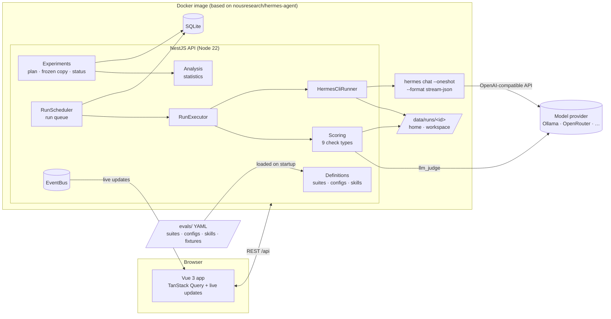
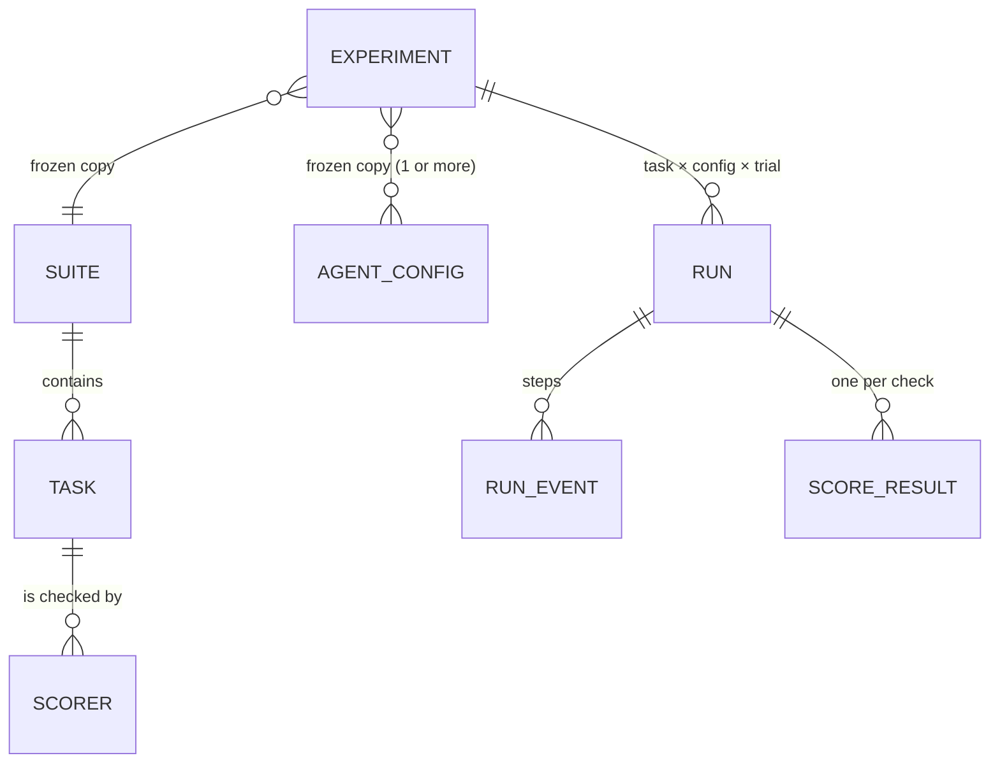

# Design: Agent Evals Platform

This document explains how the platform answers one question:

> _"Did this change to the agent make it better, worse, or no different? And
> how sure are we?"_

It also explains why it is built this way.

- [1. Goals](#1-goals)
- [2. Architecture](#2-architecture)
- [3. Data model](#3-data-model)
- [4. Running a task on Hermes](#4-running-a-task-on-hermes)
- [5. Checking runs (scoring)](#5-checking-runs-scoring)
- [6. Statistics: how sure can we be?](#6-statistics-how-sure-can-we-be)
- [7. The run queue](#7-the-run-queue)
- [8. API and UI](#8-api-and-ui)
- [9. Main decisions and trade-offs](#9-main-decisions-and-trade-offs)
- [10. Assumptions](#10-assumptions)
- [11. How it could grow](#11-how-it-could-grow)

## 1. Goals

**What it must do**

1. Let people write tasks, and how each task is checked, as files that can be
   reviewed like code.
2. Let people write agent configurations (model, tools, skills, memory,
   persona, turn limit) and compare two or more of them.
3. Run every task with every configuration, several times, using the real
   Hermes Agent. Each run must be separate from every other run.
4. Say clearly if a configuration is better, worse, or not different, and be
   honest about uncertainty.
5. Let a person open any run and see _why_ it passed or failed: the checks and
   their evidence, every step the agent took, and the files it left behind.
6. Start locally with one command.

**What it does not try to do (for now)**

- Features for many customers, like logins, quotas or billing. It is an
  internal tool.
- Running across many machines. The design leaves room for this (see §11).
- Improving prompts or training models. It only measures.

## 2. Architecture



**One thing to deploy.** The API also serves the frontend. It starts every
agent run as a child process. Everything runs in one Docker image built on top
of the official `nousresearch/hermes-agent` image. `docker compose up --build`
is the whole setup.

**Backend modules** (each one has one job):

| Module        | Job                                                                                                                                              |
| ------------- | ------------------------------------------------------------------------------------------------------------------------------------------------ |
| `definitions` | Reads suites, configs and skills from YAML files, checks they are valid, gives each version a short hash, and lets the UI create and edit them.  |
| `experiments` | Creates experiments (the run plan plus a frozen copy of the definitions), lists runs, builds reports, handles cancel/retry/delete, live updates. |
| `execution`   | The run queue, running one run from start to end, the Hermes runner, and the run folders.                                                        |
| `scoring`     | The nine check types, including the LLM judge.                                                                                                   |
| `analysis`    | Pure statistics code and the report builder. No framework code, so it is easy to test.                                                           |
| `events`      | Sends live updates to browsers and messages between modules.                                                                                     |

**Shared rules.** `packages/shared` holds the validation rules (zod schemas)
for tasks, checks, configs and experiment requests, and the types of every API
response. The backend and the frontend use the same rules, so they cannot get
out of sync.

## 3. Data model



- **Suite / Task / Check** — written as files in `evals/suites/*.yaml`. A task
  has a prompt, an optional folder of starting files, limits (time and number
  of turns) and a list of checks.
- **AgentConfig** — the thing we are testing: the model (provider, name,
  address, price), toolsets, skills, memory (on or off, plus starting notes),
  persona, turn limit, and an option to set any other Hermes setting.
- **Experiment** — tasks × configs × tries. When it starts, it saves a
  **frozen copy** of every definition with its hash. If someone edits a suite
  later, old experiments still mean exactly what they meant.
- **Run** — one task with one config, one time: its status, pass/fail, score,
  tokens and cost, final answer, files, steps and check results.

Data is stored in SQLite using Drizzle ORM. The database migrations are in
`apps/api/drizzle`.

## 4. Running a task on Hermes

### How we call Hermes

Hermes can be used in two ways: as a Python library, or as a command-line
tool. The platform uses **the official command-line "one-shot" mode**:

```
hermes --usage-file <run>/usage.json chat --oneshot --query-file <run>/prompt.txt \
  --format stream-json --source tool --yolo --max-turns N --toolsets file,terminal [--skills …]
```

- `--format stream-json` prints one JSON line for every step (text, tool call,
  tool result, final result). This gives us the agent's full list of steps.
- `--usage-file` writes the tokens used, the number of model calls, the cost,
  and why the run stopped. It does this even when the run fails.
- It works from any language (Node starts it directly). Every run is its own
  process. And it is the way Hermes officially supports for scripts. Hermes'
  own guide says its Python internals are not a stable API.

### Every run is separate

Every run gets a new folder `/data/runs/<runId>/` with:

| Folder       | What it is for                                                                                                                                                                                     |
| ------------ | -------------------------------------------------------------------------------------------------------------------------------------------------------------------------------------------------- |
| `home/`      | A brand-new Hermes setup (`HERMES_HOME`): its own `config.yaml`, persona, starting memory notes, and only the skills the config asks for. Hermes' built-in skills are turned off unless asked for. |
| `workspace/` | The agent's working folder, with the task's starting files. Hermes is told (`HERMES_WRITE_SAFE_ROOT`) that it may only write files here.                                                           |
| `rt/`        | A private folder for Hermes' temporary sockets and locks.                                                                                                                                          |

The generated `config.yaml` fixes everything that is _not_ being tested. For
example, Hermes' background "learning" step and its title generation are
turned off, because they add cost and randomness that have nothing to do with
the task.

The Hermes process gets **only the environment variables it needs**: `PATH`,
language settings, Hermes' own variables, and only the one API key the config
names. Other secrets (like the judge's key) are never passed to the agent,
because the agent can run any shell command.

### What counts as a failure

| What Hermes reports                                       | Run status                      | How it counts                             |
| --------------------------------------------------------- | ------------------------------- | ----------------------------------------- |
| finished normally (`exit_code = 0`)                       | completed                       | checked normally                          |
| used up its turn limit                                    | completed, marked `max_turns`   | checked (usually fails) — agent's fault   |
| took longer than the time limit                           | completed, marked `timeout`     | checked — agent's fault                   |
| provider error: HTTP 401/402/403/429/5xx, quota, network  | **infra error**                 | tried again later, then left out of stats |
| failed before calling the model at all, or no result line | **infra error** (setup problem) | tried again later, then left out of stats |
| experiment was cancelled                                  | cancelled                       | left out                                  |

The rule "failed before calling the model = setup problem" came from a real
bug we found while building this. Hermes rejected a command-line option and
exited with code 1, and at first this was counted as the agent failing. Now a
broken setup cannot make a model look worse.

### Hermes background processes

Every time `hermes chat` runs, it starts a small background service (a
"gateway") that keeps running after the command ends. With several runs at
once, this caused two problems, and both are now handled:

1. **Leftover processes.** After each run, the runner finds every process that
   belongs to that run's Hermes setup and stops it. The config also tells the
   gateway to shut down quickly when idle, as a backup. Before this fix, a
   retry in the same folder clashed with the old gateway, and memory use grew
   by about 250 MB for every finished run.
2. **Too many starting at once.** When several Hermes processes start at the
   same moment, they fight for CPU and some miss Hermes' 60-second start limit.
   Now only one run starts at a time. As soon as it takes its first real step,
   the next one starts. After start-up, runs still work in parallel.

## 5. Checking runs (scoring)

A check looks at the end of a run and gives back:
`score` (0 to 1), `passed` (yes/no), `reason` (one sentence a person can
read), and `evidence` (the raw details, like command output or the judge's
explanation).

| Check type    | What it looks at                                                                   | Typical use                           |
| ------------- | ---------------------------------------------------------------------------------- | ------------------------------------- |
| `contains`    | does the answer or a file contain these values? (`negate` = must not contain them) | facts, leaked secrets                 |
| `exact_match` | is the answer exactly this (ignoring extra spaces, quotes, capitals)?              | IDs, one-word answers                 |
| `regex`       | does the text match a pattern?                                                     | formats, config lines                 |
| `numeric`     | is the last (or first) number close enough?                                        | calculations                          |
| `json_field`  | is the value at this JSON path correct?                                            | structured output                     |
| `file_exists` | does this file exist (or not)?                                                     | required output files                 |
| `command`     | does this shell command succeed? Can first copy in **hidden files** like tests     | hidden unit tests                     |
| `tool_usage`  | how many times was a tool used?                                                    | "must use X" / "must not use X"       |
| `llm_judge`   | a judge model gives a 0–10 score using a rubric, with temperature 0                | quality that simple checks cannot see |

**Task score** is the weighted average of its check scores, so partial credit
counts. **Pass or fail:** every check marked `required` must pass, and then
either every check passes (the default) or the score reaches the task's
`passThreshold`. The main number we compare is the **pass rate**. The average
score is a second number.

Design choices:

- **Check the end result, not the conversation.** Hidden tests are copied in
  only _after_ the agent finishes, so the agent cannot see them or cheat.
- **Rule-based checks first, judge second.** The sample suites use the LLM
  judge on only two writing tasks, always together with rule-based checks.
  The judge is a different model family from the models being tested, so it
  does not favour itself.
- **Broken checks are visible.** If a check cannot run (for example, the judge
  is down), it is marked as an error, counts as failed, and the report shows a
  warning.
- **Hermes' extra notes are removed** from the final answer before checking.
  (Hermes sometimes adds a note about failed file edits, which would confuse a
  number check.) The full text is still kept in the run's steps.

## 6. Statistics: how sure can we be?

Agents are random: the same agent can pass a task once and fail it the next
time. Tasks are also very different in difficulty. So the statistics are built
on two ideas:

1. **We count by task, not by run.** Three tries of the same task are not
   three independent results. If we treated 72 runs as 72 separate results,
   we would be far too confident. So each task gives one number: its average
   over the tries.
2. **We compare task by task.** Both configs run the same tasks. So for each
   task we look at the difference between the two configs. This removes the
   noise that comes from some tasks being harder than others.

| What we report                         | How it is calculated                                                                                                                                                                                                                                                         |
| -------------------------------------- | ---------------------------------------------------------------------------------------------------------------------------------------------------------------------------------------------------------------------------------------------------------------------------- |
| Pass rate and average score per config | the average over tasks of each task's average                                                                                                                                                                                                                                |
| 95% confidence range per config        | **bootstrap in two levels**: many times, pick tasks at random (with repeats), then pick tries within each task, and recompute. The middle 95% of the results is the range (4,000 rounds).                                                                                    |
| Difference from the baseline           | the average of the per-task differences, with a 95% range from the same method                                                                                                                                                                                               |
| p-value                                | **sign-flip test**: if the two configs were really the same, each task's difference would be equally likely to be positive or negative. We check how often random sign flips give a difference as big as the real one. Exact for up to 16 tasks. No "bell curve" assumption. |
| More than two configs                  | **Holm correction**: the p-values are adjusted, because comparing many configs makes lucky results more likely                                                                                                                                                               |
| Smallest difference we could detect    | **minimum detectable effect** at 80% power: `(z₀.₉₇₅ + z₀.₈) · sd(differences) / √n`                                                                                                                                                                                         |
| Verdict                                | `better` or `worse` only if the adjusted p-value is below 0.05 **and** the 95% range does not include 0. Otherwise `no detectable difference`. Fewer than 2 tasks: `insufficient data`.                                                                                      |

The verdict sentence always gives the difference, the range, the p-value and
the number of tasks. When the verdict is "no detectable difference", it also
says how big a difference the experiment could have noticed. So "we could not
see a difference" is never presented as "they are equal".

Other practices that keep results fair:

- **Mixed, repeatable run order.** Runs of all configs are shuffled together.
  If the provider gets slow or limits requests for a while, every config is
  affected equally.
- **Provider and setup errors are left out**, counted, and can be re-run from
  the UI. An outage cannot make a config look worse.
- **Flaky tasks** (passed some tries, failed others) are marked.
- **Repeatable results.** All random steps in the statistics use the
  experiment's seed, so the same data always gives the same report.

## 7. The run queue

The `runs` table in the database _is_ the queue.

- **Taking the next run** happens in one database transaction: pick the next
  run (oldest experiment first, then the shuffled order) whose experiment is
  below its own limit, and mark it as `running`. The database driver is
  synchronous and there is only one scheduler, so two workers can never take
  the same run.
- **Limits.** `MAX_CONCURRENCY` limits how many runs run at once in total.
  Each experiment also has its own limit.
- **Waking up.** The scheduler wakes up when an experiment starts or is
  retried, and also checks every 5 seconds just in case.
- **Recovering after a crash.** On startup, runs that were left as `running`
  go back into the queue, and their half-finished steps are deleted. On a
  normal shutdown, running runs are stopped and put back in the queue (not
  marked as cancelled).
- **Retries.** Provider or setup errors are retried up to `RUN_MAX_ATTEMPTS`
  times. The wait between tries gets longer each time, so a busy provider gets
  a break. The retried run goes to the end of the queue.
- **Cancelling** marks waiting runs as cancelled and stops running ones,
  including their background processes.

## 8. API and UI

The API is REST under `/api` (full list in the README). Live progress uses
Server-Sent Events (`/api/experiments/:id/stream`, `/api/runs/:id/stream`).
All errors have the same JSON shape (`statusCode`, `error`, `message`,
`details`).

The UI (Vue 3, TypeScript, Vue Router, TanStack Query, Tailwind) is built
around the questions people ask:

- **Experiment page — "which one is better, and how sure are we?"** A result
  card in plain words with the difference, the range, the adjusted p-value,
  wins/losses/ties and the smallest detectable difference. Charts of each
  config's pass rate with its range. A chart of the difference from the
  baseline. A cost and speed table. A task × config table (each cell shows
  passes/runs as text, so colour is never the only signal; clicking a cell
  filters the runs). The list of runs. An explanation of the method.
- **Run page — "why did it pass or fail?"** A one-line summary (the first
  failing check). Each check with its reason and evidence. The final answer.
  Every step, with each tool call next to its result. The files after the run,
  marked as new or edited, with a file viewer. The exact config used and the
  Hermes log.
- **Suites and configs** — browse tasks and checks. Create suites in a YAML
  editor and configs in a form. Both are validated live with the same rules
  as the backend.

Charts use a colour-blind-safe set of colours for the configs (always the same
colour for the same config), one blue scale for the task table, and status
colours that always come with an icon and a label. There is a light and a
dark theme.

## 9. Main decisions and trade-offs

| Decision                                                        | Other options we considered                  | Why we chose this                                                                                                                                                                                 |
| --------------------------------------------------------------- | -------------------------------------------- | ------------------------------------------------------------------------------------------------------------------------------------------------------------------------------------------------- |
| Use Hermes' official one-shot command-line mode                 | Call Hermes' Python library through a helper | It is the official interface, each run is its own process, there is no Python bridge to maintain, and we get steps and usage for free. Cost: 5–10 s of start-up per run.                          |
| A fresh Hermes setup for every run                              | Hermes profiles; one shared setup            | Memory and skills belong to a setup. A shared setup would leak memory between runs and configs.                                                                                                   |
| Tasks and configs as YAML files, copied to the DB with a hash   | Only store them in the database              | Tasks deserve code review and history. The DB copy and the frozen copies in experiments keep old results meaningful. Creating them in the UI still works.                                         |
| SQLite + Drizzle, with the runs table as the queue              | Postgres + BullMQ/Redis                      | One command to run locally, no extra services. Transactions make the queue safe on one machine. Drizzle makes a later move to Postgres simple.                                                    |
| Compare task by task, count by task, no "bell curve" maths      | A simple t-test or chi-square test per run   | Runs of the same task are not independent, and pass rates are between 0 and 1. The bootstrap and sign-flip test work well even with few tasks.                                                    |
| Provider errors are retried and left out; timeouts are failures | Count every problem as a failure             | A provider outage should not punish a config. A slow agent should.                                                                                                                                |
| One container for the API and Hermes                            | Start a new Docker container for every run   | Giving the app access to Docker is a bigger security risk than the isolation it adds. Separate folders, the write limit and a minimal environment are enough for trusted tasks (see LIMITATIONS). |
| Server-Sent Events for live updates                             | WebSockets, polling                          | Updates only go from server to browser; it works through proxies and is simple in NestJS.                                                                                                         |
| Shared zod rules for backend and frontend                       | class-validator DTOs                         | One set of validation rules for both sides.                                                                                                                                                       |

## 10. Assumptions

- **Hermes Agent v0.22.1** (the Docker image version is fixed) and its
  official one-shot command-line mode. Newer versions should work; unknown
  output lines are ignored.
- Tasks are **one message long**: the user sends one message, then the agent
  works on its own until it answers. Conversations where a simulated user
  replies in the middle are out of scope.
- Tasks and checks are **trusted code**, reviewed like any other code. (Check
  commands run inside the container.)
- By default, agents work **offline** (file and terminal tools). Web and
  browser tools work too, but they need network access and keys, and make
  results less repeatable.
- Models can come from **any provider Hermes supports**. The sample configs
  use Ollama (running on your computer, optionally with Ollama Cloud models,
  which were free at the time of writing), so no paid key is needed.
- **Cost** uses Hermes' own estimate when Hermes knows the model's price.
  Otherwise it uses the prices in the config (OpenRouter list prices for the
  open models, October 2026). Otherwise it shows "unknown", never a fake zero.
- A difference is "significant" if the adjusted p-value is below 0.05. Ranges
  are 95%. The smallest detectable difference uses 80% power.
- The judge model is the same for the whole deployment (`JUDGE_MODEL`).
  Changing the judge between experiments makes judged checks hard to compare.

## 11. How it could grow

The places to change for running beyond one machine already exist:

- **Queue:** `RunsRepository.claimNext` is the only place that hands out work.
  Moving to Postgres (`SELECT … FOR UPDATE SKIP LOCKED`) or to a message
  broker would let many workers take runs.
- **Runner:** `AgentRunner` is an interface. A `RemoteHermesRunner` could run
  each run in its own container or Kubernetes job for stronger isolation, with
  the same steps and results.
- **Live updates:** `EventBus` works inside one process. Redis or NATS could
  share live updates across several API servers without changing the callers.
- **Files:** run folders live under `DATA_DIR`. An object store (like S3)
  could hold them when there are several machines.
- **Statistics** are cheap (milliseconds for hundreds of runs).
