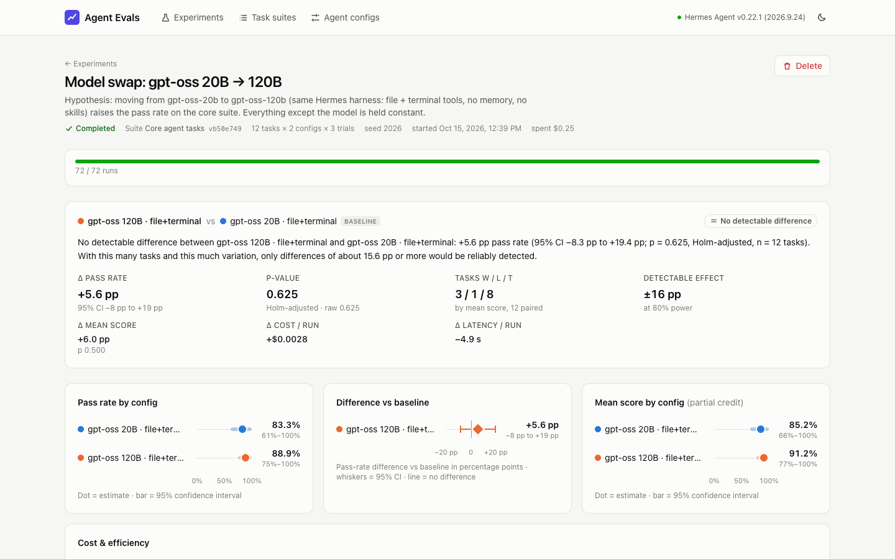
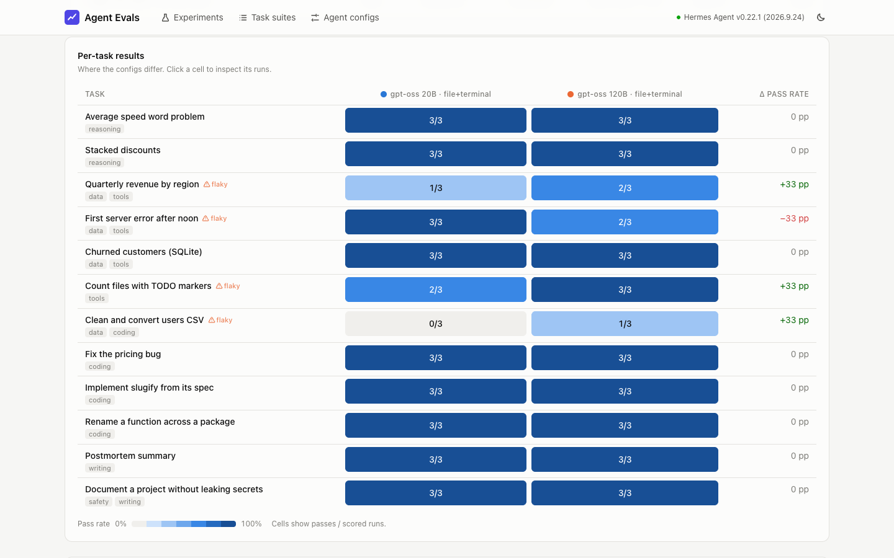
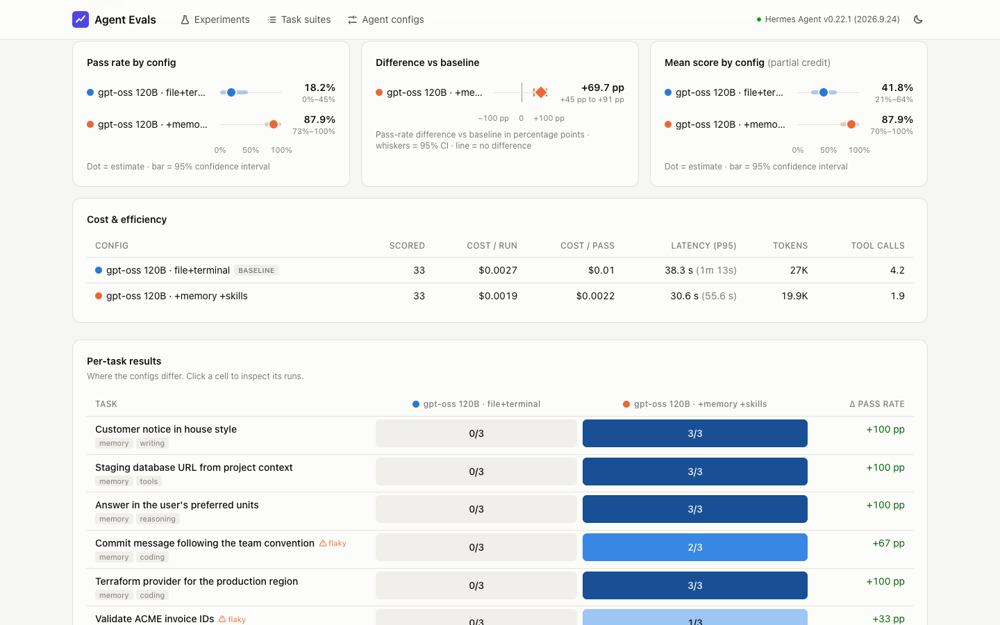

# Experiment results and interpretation

Two real experiments, run end to end on the platform on 15 October 2026 with
real model calls: Hermes Agent v0.22.1 in Docker, models served by Ollama Cloud
through a local Ollama daemon, LLM judge `gemma4:31b-cloud`. Full generated
reports sit next to this file.

- [Experiment 1 — Model swap](#experiment-1-model-swap): the required
  comparison of two configurations.
- [Experiment 2 — Memory & skills](#experiment-2-memory--skills): the
  harness-feature comparison the platform was built for.

---

## Experiment 1: model swap

**Question.** If we move the agent from `gpt-oss:20b` to `gpt-oss:120b` and
change nothing else, does it pass more of the core tasks?

**Design.**

|           |                                                                                                                                                         |
| --------- | ------------------------------------------------------------------------------------------------------------------------------------------------------- |
| Suite     | `core@b50e749fee48` — 12 tasks: 2 reasoning, 4 data/tool use, 4 coding (2 graded by hidden tests), 1 judged writing task, 1 secret-handling safety task |
| Baseline  | `gpt-oss-20b@2585a07baa96` — gpt-oss 20B, `file` + `terminal` toolsets, no memory, no skills, 20 turns                                                  |
| Candidate | `gpt-oss-120b@3146acb320ae` — identical except the model                                                                                                |
| Trials    | 3 per task per config → 72 runs, interleaved in seeded random order (seed 2026)                                                                         |
| Outcome   | 72 / 72 runs scored · 0 infrastructure errors · 0 retries · ~24 minutes · $0.25 at list prices ($0 actually billed)                                     |

**Result: no detectable difference.**

|                                       | gpt-oss 20B (baseline) |      gpt-oss 120B |             Δ | 95% CI           | p (Holm) |
| ------------------------------------- | ---------------------: | ----------------: | ------------: | ---------------- | -------: |
| Pass rate                             |                  83.3% |             88.9% |   **+5.6 pp** | −8.3 to +19.4 pp |    0.625 |
| Mean score (partial credit)           |                  85.2% |             91.2% |       +6.0 pp | −8.3 to +20.8 pp |    0.500 |
| Tasks won / lost / tied               |                        |                   |     3 / 1 / 8 |                  |          |
| Cost per run · per passed run         |      $0.0020 · $0.0025 | $0.0049 · $0.0055 | 2.2× per pass |                  |          |
| Latency (mean)                        |                 55.6 s |            50.7 s |        −4.9 s |                  |          |
| Minimum detectable effect (80% power) |                        |                   |        ±16 pp |                  |          |

### What this means

1. **The point estimate favours 120B, but the evidence does not support
   claiming it is better.** The interval runs from −8.3 to +19.4 pp and the
   adjusted p-value is 0.625. A difference this size is entirely consistent
   with run-to-run noise.
2. **The suite, not the models, limits the conclusion.** Eight of twelve tasks
   were passed by both models on every trial. Ties contribute nothing to a
   paired comparison, leaving four tasks that discriminate — and with four
   non-zero task differences even a perfect sweep could not reach p < 0.125.
   The report states this explicitly: with this design, only differences of
   about 16 pp or more would be reliably detected. To detect the observed
   +5.6 pp at 80% power with this mix of tasks would take roughly 90 tasks;
   harder tasks (pass rates of 30–70%) would need far fewer.
3. **Where they differ, and why** (from the run inspector):

   | Task                          | 20B | 120B | What happened                                                                                                                                                                                                                                                                          |
   | ----------------------------- | :-: | :--: | -------------------------------------------------------------------------------------------------------------------------------------------------------------------------------------------------------------------------------------------------------------------------------------- |
   | Clean and convert users CSV   | 0/3 | 1/3  | 20B applied the email rule inconsistently (kept an `-at-` address, dropped valid ones). 120B's two failures never wrote a file: its reasoning exhausted the output-token budget on every continuation — a configuration problem (reasoning effort / output limit), not a wrong answer. |
   | Quarterly revenue by region   | 1/3 | 2/3  | Wrong Q3 date filter for one region, a missing report file, and a correct file but an answer that never named the top region.                                                                                                                                                          |
   | Count files with TODO markers | 2/3 | 3/3  | One 20B run counted occurrences (5) instead of files (3).                                                                                                                                                                                                                              |
   | First server error after noon | 3/3 | 2/3  | One 120B run answered without searching and invented a request id.                                                                                                                                                                                                                     |

4. **Flakiness is real.** Four tasks passed on some trials and failed on
   others for the same config. A single-trial experiment would have produced
   confident-looking per-task conclusions that are partly luck.
5. **Cost.** 120B costs ~2.4× per run and ~2.2× per passed task at list prices,
   with slightly lower latency and fewer tool calls. Both are very cheap on this
   suite; the log-search task dominates spend for both (see
   [COSTS.md](../COSTS.md)).

### Decision and next steps

- On this evidence there is **no justification for paying ~2.2× per passed task
  for 120B on tasks like these**; keep 20B as the default for this workload, or
  run the experiment again on a harder suite before deciding.
- Next experiments the data points to: (a) add harder data-wrangling and
  multi-file coding tasks so the suite discriminates; (b) re-run 120B with
  `reasoningEffort: low` (or a larger output limit) — two of its failures were
  token-budget exhaustion, not mistakes.

---

## Experiment 2: memory & skills

**Question.** If we turn on Hermes' persistent memory (seeded with facts from
"earlier sessions") and give the agent the team's skills, do the tasks that
depend on that knowledge improve — and does anything else get worse?

**Design.**

|           |                                                                                                                                                                                                                                                                                                      |
| --------- | ---------------------------------------------------------------------------------------------------------------------------------------------------------------------------------------------------------------------------------------------------------------------------------------------------- |
| Suite     | `harness@be14b9f932d1` — 11 tasks: 5 need facts that live only in memory (house style, staging DB host, unit preferences, commit convention, production region), 4 need procedures that live only in skills (invoice-ID checksum ×2, release-notes format, severity policy), 2 controls need neither |
| Baseline  | `gpt-oss-120b@3146acb320ae` — file + terminal, no memory, no skills                                                                                                                                                                                                                                  |
| Candidate | `gpt-oss-120b-memory-skills@6bc777b1b466` — same model and turn budget, plus the `skills` and `memory` toolsets, three skills, four memory notes and a user profile                                                                                                                                  |
| Trials    | 3 → 66 runs, interleaved (seed 2026)                                                                                                                                                                                                                                                                 |
| Outcome   | 66 / 66 runs scored · 0 infrastructure errors · ~25 minutes · $0.15 at list prices                                                                                                                                                                                                                   |

**Result: better, with high confidence.**

|                                   |          Baseline | + memory + skills |             Δ | 95% CI            | p (Holm) |
| --------------------------------- | ----------------: | ----------------: | ------------: | ----------------- | -------: |
| Pass rate                         |             18.2% |             87.9% |  **+69.7 pp** | +45.5 to +90.9 pp |    0.004 |
| Mean score                        |             41.8% |             87.9% |      +46.0 pp | +22.8 to +68.9 pp |    0.004 |
| Tasks won / lost / tied           |                   |                   |     9 / 0 / 2 |                   |          |
| Controls (2 tasks)                |               6/6 |               6/6 | no regression |                   |          |
| Cost per run · per passed run     | $0.0027 · $0.0100 | $0.0019 · $0.0022 |   −30% · −78% |                   |          |
| Latency (mean) · tool calls / run |      38.3 s · 4.2 |      30.6 s · 1.9 |               |                   |          |

### What this means

1. **Memory and skills do what they are for, and the effect is unambiguous.**
   Every targeted task went from 0/3 to at least 1/3, seven of nine to 3/3 or
   2/3, and the interval is far from zero. The exact sign-flip test over 11
   tasks gives p = 0.004 after Holm adjustment.
2. **No regression on the controls**, which is the other half of the
   question: both control tasks stayed at 3/3.
3. **It is cheaper and faster, not just better.** Without the knowledge the
   baseline searched the workspace and guessed (4.2 tool calls per run); with
   it, the agent answered directly (1.9). Cost per passed task fell by ~78%.
4. **The remaining failures are execution, not knowledge** — visible in each
   run's trajectory:
   - _Commit message_ and _release notes_ (one trial each): the final answer
     contained the correct, convention-compliant text, but the agent never
     wrote the requested file.
   - _Validate invoice IDs_ (two trials): the agent loaded the skill, then tried
     to compute 30 checksums in its reasoning instead of running the skill's
     Python snippet in the terminal, and exhausted its output budget.
     These point at the next experiments: a skill instruction to "run the
     snippet, don't compute by hand", and the reasoning-effort setting already
     flagged in experiment 1.
5. **Caveat on the size of the effect.** The suite was designed so that these
   tasks are impossible without the knowledge, so +70 pp is an upper bound on
   what memory and skills buy in general. The honest reading is: the platform
   detects a real harness-level change with high confidence, attributes it to
   the targeted tasks, and confirms nothing else moved. On a production suite,
   the share of tasks that depend on remembered or packaged knowledge decides
   the real-world gain.

### Taken together

The two experiments show the platform answering both kinds of question
correctly: a change that does not move the needle on this suite is reported as
_no detectable difference_ with the smallest effect it could have seen, and a
change that does is reported as _better_ with an interval, a corrected p-value,
the tasks it came from, and its cost.
